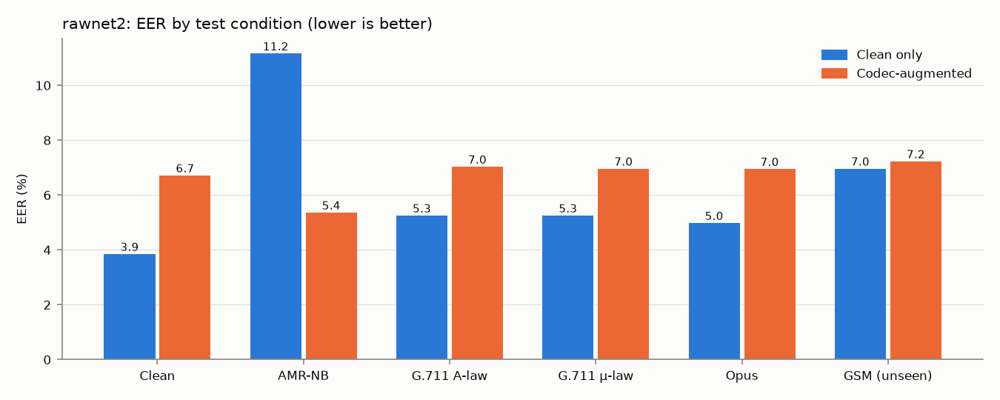

# Results

> Auto-generated by `python -m voxguard.evaluate` from `results/*.json`. Do not edit by hand.
> Generated: 2026-11-21T14:17:07+00:00.

EER: equal error rate (lower is better). Scores are P(fake); a clip is called fake when its score is at or above the threshold. Eval crops the first ~4 s of each clip.

## rawnet2

### 2x2 matrix: EER (%)

| Train \ Test | Clean | Phone-degraded (pooled) |
|---|---|---|
| Clean only | 3.85 | 7.43 |
| Codec-augmented | 6.72 | 6.59 |

### Phone-degraded EER (%) per codec

| Train | amr_nb | g711_alaw | g711_mulaw | opus |
|---|---|---|---|---|
| Clean only | 11.16 | 5.25 | 5.25 | 4.98 |
| Codec-augmented | 5.36 | 7.04 | 6.96 | 6.95 |

### Unseen-codec EER (%): codecs not used in any training run

| Train | gsm |
|---|---|
| Clean only | 6.96 |
| Codec-augmented | 7.23 |

### Accuracy (%) at the EER threshold / at 0.5

| Train \ Test | Clean | Phone-degraded |
|---|---|---|
| Clean only | 96.15 / 95.84 | 92.56 / 96.23 |
| Codec-augmented | 93.29 / 86.98 | 93.41 / 87.35 |

### Operating points chosen on dev: eval HTER (%)

HTER = (FPR + FNR) / 2 at a fixed threshold picked on the dev set (`thresholds.json`), unlike the EER above, which picks the best threshold on the eval set itself. The API uses the phone threshold. GSM never picks a threshold.

| Train | Clean thr | Phone thr | Clean eval @ clean thr | Phone eval @ phone thr | Phone eval @ clean thr | Unseen codec @ phone thr |
|---|---|---|---|---|---|---|
| Clean only | 0.9764 | 0.9978 | 6.11 | 10.51 | 7.70 | 7.99 |
| Codec-augmented | 0.2963 | 0.2161 | 6.88 | 6.61 | 6.88 | 7.08 |

### low_far operating point chosen on dev: eval false alarms / missed fakes (%)

The phone threshold at which at most the stated share of dev fakes is missed, applied to eval: real clips called fake / fakes missed. It trades false alarms for fewer misses; the API uses it only when an operator sets it explicitly.

| Train | low_far thr | Dev fakes missed (target) | Clean eval | Phone eval | Unseen codec |
|---|---|---|---|---|---|
| Clean only | 0.6691 | 0.1 | 2.35 / 5.04 | 20.57 / 1.70 | 40.06 / 0.93 |
| Codec-augmented | 0.004606 | 0.1 | 12.48 / 4.76 | 12.43 / 4.38 | 15.57 / 3.76 |

### Out-of-domain (In-the-Wild): EER and errors at the dev phone threshold

Real-world speech of public figures (Mueller et al., Interspeech 2022), not telephone audio and never used for training or thresholds. "Whole clip" scores every ~4 s window and averages them, as the API does with an upload; "first 4 s" is the crop used for every other table. False alarms = real clips called fake, at the phone threshold the API uses (whole-clip scores where available).

| Train | EER, whole clip | EER, first 4 s | False alarms @ phone thr | Missed fakes @ phone thr | Clips |
|---|---|---|---|---|---|
| Clean only | 41.23 | 39.43 | 51.03 | 29.75 | 31779 |
| Codec-augmented | 42.48 | 40.41 | 72.91 | 9.35 | 31779 |

### Hindi generalisation (small set): EER and errors at the dev phone threshold

Real Hindi read speech (Google FLEURS hi_in test) vs one open Hindi TTS voice (facebook/mms-tts-hin, CC-BY-NC) speaking the same transcripts, loudness-matched. Training and thresholds are English-only; a small check, not a language claim. "Whole clip" scores every ~4 s window and averages them, as the API does with an upload; "first 4 s" is the crop used for every other table. False alarms = real clips called fake, at the phone threshold the API uses (whole-clip scores where available).

| Train | EER, whole clip | EER, first 4 s | False alarms @ phone thr | Missed fakes @ phone thr | Clips |
|---|---|---|---|---|---|
| Clean only | 16.51 | 21.05 | 37.56 | 8.61 | 836 |
| Codec-augmented | 21.77 | 25.84 | 65.31 | 4.78 | 836 |

### Latency per ~4 s clip (ms, batch 1)

| Device | p50 | p95 | mean | clips |
|---|---|---|---|---|
| cpu | 38.5 | 39.1 | 38.5 | 50 |
| mps | 24.7 | 24.9 | 24.7 | 50 |

Clips scored: Clean only on clean: n=10000; Clean only on degraded: n=40000; Clean only on heldout: n=10000; Clean only on in_the_wild: n=31779; Clean only on hindi: n=836; Codec-augmented on clean: n=10000; Codec-augmented on degraded: n=40000; Codec-augmented on heldout: n=10000; Codec-augmented on in_the_wild: n=31779; Codec-augmented on hindi: n=836.

## ssl_aasist

### 2x2 matrix: EER (%)

| Train \ Test | Clean | Phone-degraded (pooled) |
|---|---|---|
| Clean only | 2.33 | 5.30 |
| Codec-augmented | 1.41 | 1.94 |

### Phone-degraded EER (%) per codec

| Train | amr_nb | g711_alaw | g711_mulaw | opus |
|---|---|---|---|---|
| Clean only | 6.00 | 1.88 | 1.88 | 3.85 |
| Codec-augmented | 1.69 | 1.31 | 1.31 | 2.44 |

### Unseen-codec EER (%): codecs not used in any training run

| Train | gsm |
|---|---|
| Clean only | 4.78 |
| Codec-augmented | 2.43 |

### Accuracy (%) at the EER threshold / at 0.5

| Train \ Test | Clean | Phone-degraded |
|---|---|---|
| Clean only | 97.68 / 52.96 | 94.70 / 62.82 |
| Codec-augmented | 98.59 / 43.81 | 98.06 / 43.42 |

### Operating points chosen on dev: eval HTER (%)

HTER = (FPR + FNR) / 2 at a fixed threshold picked on the dev set (`thresholds.json`), unlike the EER above, which picks the best threshold on the eval set itself. The API uses the phone threshold. GSM never picks a threshold.

| Train | Clean thr | Phone thr | Clean eval @ clean thr | Phone eval @ phone thr | Phone eval @ clean thr | Unseen codec @ phone thr |
|---|---|---|---|---|---|---|
| Clean only | 0.001589 | 0.005212 | 11.09 | 12.30 | 7.04 | 8.30 |
| Codec-augmented | 0.01378 | 0.01268 | 11.31 | 8.38 | 10.77 | 7.20 |

### low_far operating point chosen on dev: eval false alarms / missed fakes (%)

The phone threshold at which at most the stated share of dev fakes is missed, applied to eval: real clips called fake / fakes missed. It trades false alarms for fewer misses; the API uses it only when an operator sets it explicitly.

| Train | low_far thr | Dev fakes missed (target) | Clean eval | Phone eval | Unseen codec |
|---|---|---|---|---|---|
| Clean only | 0.001322 | 0.1 | 0.09 / 18.24 | 2.93 / 9.15 | 6.29 / 3.54 |
| Codec-augmented | 0.0093 | 0.1 | 1.31 / 1.47 | 2.91 / 1.26 | 3.75 / 0.68 |

### Out-of-domain (In-the-Wild): EER and errors at the dev phone threshold

Real-world speech of public figures (Mueller et al., Interspeech 2022), not telephone audio and never used for training or thresholds. "Whole clip" scores every ~4 s window and averages them, as the API does with an upload; "first 4 s" is the crop used for every other table. False alarms = real clips called fake, at the phone threshold the API uses (whole-clip scores where available).

| Train | EER, whole clip | EER, first 4 s | False alarms @ phone thr | Missed fakes @ phone thr | Clips |
|---|---|---|---|---|---|
| Clean only | 9.52 | 10.13 | 4.04 | 22.03 | 31779 |
| Codec-augmented | 13.78 | 14.92 | 19.11 | 9.46 | 31779 |

### Hindi generalisation (small set): EER and errors at the dev phone threshold

Real Hindi read speech (Google FLEURS hi_in test) vs one open Hindi TTS voice (facebook/mms-tts-hin, CC-BY-NC) speaking the same transcripts, loudness-matched. Training and thresholds are English-only; a small check, not a language claim. "Whole clip" scores every ~4 s window and averages them, as the API does with an upload; "first 4 s" is the crop used for every other table. False alarms = real clips called fake, at the phone threshold the API uses (whole-clip scores where available).

| Train | EER, whole clip | EER, first 4 s | False alarms @ phone thr | Missed fakes @ phone thr | Clips |
|---|---|---|---|---|---|
| Clean only | 45.93 | 64.59 | 2.87 | 97.85 | 836 |
| Codec-augmented | 25.36 | 44.26 | 14.35 | 38.04 | 836 |

### Latency per ~4 s clip (ms, batch 1)

| Device | p50 | p95 | mean | clips |
|---|---|---|---|---|
| cpu | 214.2 | 225.5 | 215.4 | 50 |
| mps | 80.9 | 81.3 | 80.9 | 50 |

Clips scored: Clean only on clean: n=10000; Clean only on degraded: n=40000; Clean only on heldout: n=10000; Clean only on in_the_wild: n=31779; Clean only on hindi: n=836; Codec-augmented on clean: n=10000; Codec-augmented on degraded: n=40000; Codec-augmented on heldout: n=10000; Codec-augmented on in_the_wild: n=31779; Codec-augmented on hindi: n=836.
