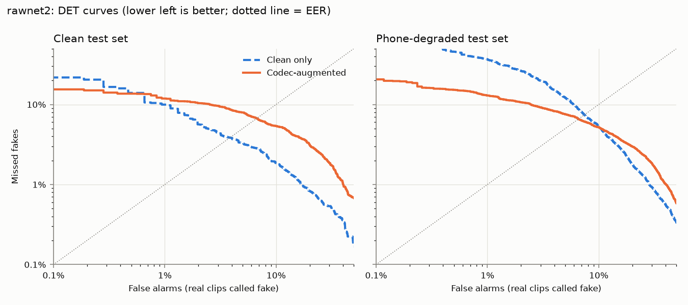
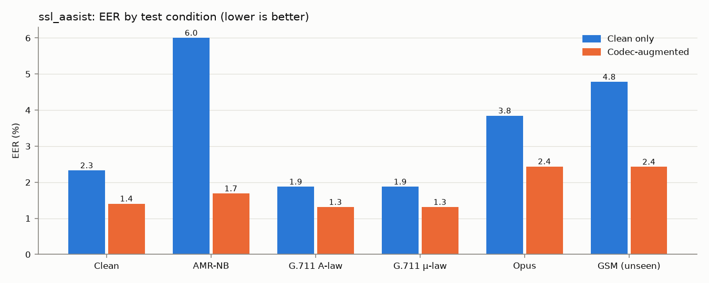
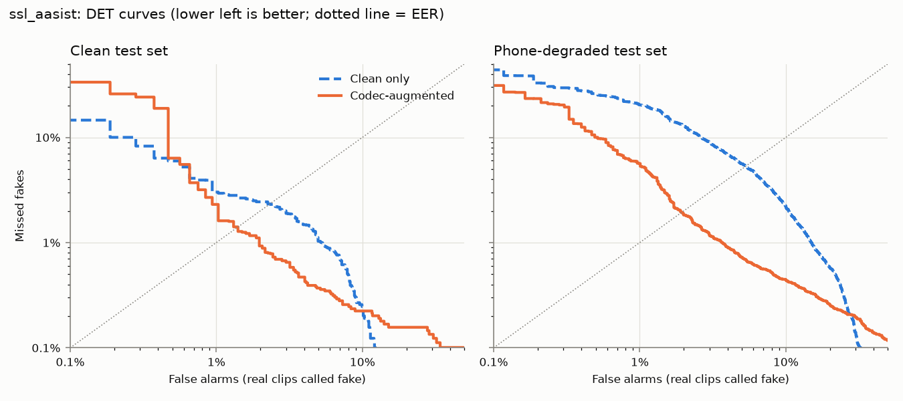

# Results

> Auto-generated by `python -m voxguard.evaluate` from `results/*.json`. Do not edit by hand.
> Generated: 2026-11-21T14:17:07+00:00.

EER: equal error rate (lower is better). Scores are P(fake); a clip is called fake when its score is at or above the threshold. Eval crops the first ~4 s of each clip.

## rawnet2

### 2x2 matrix: EER (%)

| Train \ Test | Clean | Phone-degraded (pooled) |
|---|---|---|
| Clean only | 3.85 | 7.43 |
| Codec-augmented | 6.72 | 6.59 |

### Phone-degraded EER (%) per codec

| Train | amr_nb | g711_alaw | g711_mulaw | opus |
|---|---|---|---|---|
| Clean only | 11.16 | 5.25 | 5.25 | 4.98 |
| Codec-augmented | 5.36 | 7.04 | 6.96 | 6.95 |

### Unseen-codec EER (%): codecs not used in any training run

| Train | gsm |
|---|---|
| Clean only | 6.96 |
| Codec-augmented | 7.23 |

### Accuracy (%) at the EER threshold / at 0.5

| Train \ Test | Clean | Phone-degraded |
|---|---|---|
| Clean only | 96.15 / 95.84 | 92.56 / 96.23 |
| Codec-augmented | 93.29 / 86.98 | 93.41 / 87.35 |

### Operating points chosen on dev: eval HTER (%)

HTER = (FPR + FNR) / 2 at a fixed threshold picked on the dev set (`thresholds.json`), unlike the EER above, which picks the best threshold on the eval set itself. The API uses the phone threshold. GSM never picks a threshold.

| Train | Clean thr | Phone thr | Clean eval @ clean thr | Phone eval @ phone thr | Phone eval @ clean thr | Unseen codec @ phone thr |
|---|---|---|---|---|---|---|
| Clean only | 0.9764 | 0.9978 | 6.11 | 10.51 | 7.70 | 7.99 |
| Codec-augmented | 0.2963 | 0.2161 | 6.88 | 6.61 | 6.88 | 7.08 |

### low_far operating point chosen on dev: eval false alarms / missed fakes (%)

The phone threshold at which at most the stated share of dev fakes is missed, applied to eval: real clips called fake / fakes missed. It trades false alarms for fewer misses; the API uses it only when an operator sets it explicitly.

| Train | low_far thr | Dev fakes missed (target) | Clean eval | Phone eval | Unseen codec |
|---|---|---|---|---|---|
| Clean only | 0.6691 | 0.1 | 2.35 / 5.04 | 20.57 / 1.70 | 40.06 / 0.93 |
| Codec-augmented | 0.004606 | 0.1 | 12.48 / 4.76 | 12.43 / 4.38 | 15.57 / 3.76 |

### Out-of-domain (In-the-Wild): EER and errors at the dev phone threshold

Real-world speech of public figures (Mueller et al., Interspeech 2022), not telephone audio and never used for training or thresholds. "Whole clip" scores every ~4 s window and averages them, as the API does with an upload; "first 4 s" is the crop used for every other table. False alarms = real clips called fake, at the phone threshold the API uses (whole-clip scores where available).

| Train | EER, whole clip | EER, first 4 s | False alarms @ phone thr | Missed fakes @ phone thr | Clips |
|---|---|---|---|---|---|
| Clean only | 41.23 | 39.43 | 51.03 | 29.75 | 31779 |
| Codec-augmented | 42.48 | 40.41 | 72.91 | 9.35 | 31779 |

### Hindi generalisation (small set): EER and errors at the dev phone threshold

Real Hindi read speech (Google FLEURS hi_in test) vs one open Hindi TTS voice (facebook/mms-tts-hin, CC-BY-NC) speaking the same transcripts, loudness-matched. Training and thresholds are English-only; a small check, not a language claim. "Whole clip" scores every ~4 s window and averages them, as the API does with an upload; "first 4 s" is the crop used for every other table. False alarms = real clips called fake, at the phone threshold the API uses (whole-clip scores where available).

| Train | EER, whole clip | EER, first 4 s | False alarms @ phone thr | Missed fakes @ phone thr | Clips |
|---|---|---|---|---|---|
| Clean only | 16.51 | 21.05 | 37.56 | 8.61 | 836 |
| Codec-augmented | 21.77 | 25.84 | 65.31 | 4.78 | 836 |

### EER (%) per attack (ASVspoof 2019 LA eval, A07-A19)

Each attack's fakes against every bona fide clip. Most eval attacks use generation methods that are not in the training set, so this is how the model does on unseen methods.

| Attack | Clean only: clean | Clean only: phone | Codec-augmented: clean | Codec-augmented: phone |
|---|---|---|---|---|
| A07 | 2.02 | 6.52 | 0.29 | 0.58 |
| A08 | 4.60 | 9.60 | 2.35 | 2.43 |
| A09 | 0.64 | 3.03 | 0.16 | 0.45 |
| A10 | 1.71 | 6.82 | 0.38 | 0.80 |
| A11 | 0.28 | 2.60 | 0.28 | 0.42 |
| A12 | 2.53 | 8.44 | 1.02 | 1.29 |
| A13 | 0.09 | 0.56 | 0.00 | 0.00 |
| A14 | 0.55 | 2.46 | 0.09 | 0.26 |
| A15 | 1.08 | 5.89 | 0.75 | 0.81 |
| A16 | 1.97 | 6.75 | 1.10 | 1.27 |
| A17 | 12.84 | 17.10 | 20.08 | 20.97 |
| A18 | 6.85 | 8.70 | 19.83 | 17.45 |
| A19 | 4.60 | 7.76 | 5.35 | 6.29 |

### Score calibration (Platt, fitted on dev phone, checked on eval phone)

Calibrated P(fake) = sigmoid(a * logit(score) + b), with bona fide and fake weighted equally. It is monotonic, so no decision changes; ECE and Brier are class-balanced (lower is better).

| Train | a | b | ECE before -> after | Brier before -> after | Phone threshold -> calibrated |
|---|---|---|---|---|---|
| Clean only | 1.197 | -6.541 | 0.114 -> 0.060 | 0.105 -> 0.066 | 0.9978 -> 0.686 |
| Codec-augmented | 0.948 | 0.854 | 0.067 -> 0.054 | 0.065 -> 0.058 | 0.2161 -> 0.409 |

### Live alert rules, Clean only (simulated phone calls)

2000 calls of 8 windows per kind, each from one speaker on one codec (one clip per ~4 s window; the live monitor's windows overlap, which this does not model). Thresholds are chosen on dev calls, numbers are on eval calls. Mixed calls are genuine for 4 windows, then fake. The fixed rule's dev false-alarm rate is 0.00 %.

| Rule | Genuine calls alerted (%) | Fake calls detected (%) | Windows to alert (median) | Mixed: early false alert (%) | Mixed: detected (%) | Mixed: windows after switch (median) |
|---|---|---|---|---|---|---|
| Fixed: 1.5 x the phone threshold, from 2 windows (the API's live monitor) | 0.00 | 0.00 | nan | 0.00 | 0.00 | nan |
| Fixed at the phone threshold itself, from 2 windows (before #104) | 2.75 | 84.05 | 2.0 | 2.70 | 0.40 | 3.0 |
| Sequential, same dev false-alarm rate as the fixed rule | 0.00 | 34.00 | 2.0 | 0.00 | 0.00 | nan |
| Sequential, at most 1% of dev genuine calls | 0.05 | 57.40 | 2.0 | 0.05 | 0.15 | 4.0 |

The API's rule per codec (Clean only; same simulation, calls of one codec only):

| Codec | Genuine clips | Genuine calls alerted (%) | Fake calls detected (%) | Mixed: early false alert (%) | Mixed: detected (%) |
|---|---|---|---|---|---|
| amr_nb | 1066 | 0.00 | 0.00 | 0.00 | 0.00 |
| g711_alaw | 1066 | 0.00 | 0.00 | 0.00 | 0.00 |
| g711_mulaw | 1066 | 0.00 | 0.00 | 0.00 | 0.00 |
| opus | 1066 | 0.00 | 0.00 | 0.00 | 0.00 |

### Live alert rules, Codec-augmented (simulated phone calls)

2000 calls of 8 windows per kind, each from one speaker on one codec (one clip per ~4 s window; the live monitor's windows overlap, which this does not model). Thresholds are chosen on dev calls, numbers are on eval calls. Mixed calls are genuine for 4 windows, then fake. The fixed rule's dev false-alarm rate is 3.50 %.

| Rule | Genuine calls alerted (%) | Fake calls detected (%) | Windows to alert (median) | Mixed: early false alert (%) | Mixed: detected (%) | Mixed: windows after switch (median) |
|---|---|---|---|---|---|---|
| Fixed: 1.5 x the phone threshold, from 2 windows (the API's live monitor) | 1.85 | 100.00 | 2.0 | 1.70 | 89.90 | 2.0 |
| Fixed at the phone threshold itself, from 2 windows (before #104) | 3.25 | 100.00 | 2.0 | 3.15 | 95.90 | 2.0 |
| Sequential, same dev false-alarm rate as the fixed rule | 1.80 | 100.00 | 1.0 | 1.30 | 96.80 | 2.0 |
| Sequential, at most 1% of dev genuine calls | 0.45 | 100.00 | 1.0 | 0.45 | 86.50 | 3.0 |

The API's rule per codec (Codec-augmented; same simulation, calls of one codec only):

| Codec | Genuine clips | Genuine calls alerted (%) | Fake calls detected (%) | Mixed: early false alert (%) | Mixed: detected (%) |
|---|---|---|---|---|---|
| amr_nb | 1066 | 3.05 | 100.00 | 2.85 | 90.85 |
| g711_alaw | 1066 | 0.95 | 100.00 | 0.90 | 89.85 |
| g711_mulaw | 1066 | 0.75 | 100.00 | 0.70 | 89.95 |
| opus | 1066 | 1.30 | 100.00 | 1.30 | 90.45 |

### Latency per ~4 s clip (ms, batch 1)

| Device | p50 | p95 | mean | clips |
|---|---|---|---|---|
| cpu | 38.5 | 39.1 | 38.5 | 50 |
| mps | 24.7 | 24.9 | 24.7 | 50 |

Clips scored: Clean only on clean: n=10000; Clean only on degraded: n=40000; Clean only on heldout: n=10000; Clean only on in_the_wild: n=31779; Clean only on hindi: n=836; Codec-augmented on clean: n=10000; Codec-augmented on degraded: n=40000; Codec-augmented on heldout: n=10000; Codec-augmented on in_the_wild: n=31779; Codec-augmented on hindi: n=836.

## ssl_aasist

### 2x2 matrix: EER (%)

| Train \ Test | Clean | Phone-degraded (pooled) |
|---|---|---|
| Clean only | 2.33 | 5.30 |
| Codec-augmented | 1.41 | 1.94 |

### Phone-degraded EER (%) per codec

| Train | amr_nb | g711_alaw | g711_mulaw | opus |
|---|---|---|---|---|
| Clean only | 6.00 | 1.88 | 1.88 | 3.85 |
| Codec-augmented | 1.69 | 1.31 | 1.31 | 2.44 |

### Unseen-codec EER (%): codecs not used in any training run

| Train | gsm |
|---|---|
| Clean only | 4.78 |
| Codec-augmented | 2.43 |

### Accuracy (%) at the EER threshold / at 0.5

| Train \ Test | Clean | Phone-degraded |
|---|---|---|
| Clean only | 97.68 / 52.96 | 94.70 / 62.82 |
| Codec-augmented | 98.59 / 43.81 | 98.06 / 43.42 |

### Operating points chosen on dev: eval HTER (%)

HTER = (FPR + FNR) / 2 at a fixed threshold picked on the dev set (`thresholds.json`), unlike the EER above, which picks the best threshold on the eval set itself. The API uses the phone threshold. GSM never picks a threshold.

| Train | Clean thr | Phone thr | Clean eval @ clean thr | Phone eval @ phone thr | Phone eval @ clean thr | Unseen codec @ phone thr |
|---|---|---|---|---|---|---|
| Clean only | 0.001589 | 0.005212 | 11.09 | 12.30 | 7.04 | 8.30 |
| Codec-augmented | 0.01378 | 0.01268 | 11.31 | 8.38 | 10.77 | 7.20 |

### low_far operating point chosen on dev: eval false alarms / missed fakes (%)

The phone threshold at which at most the stated share of dev fakes is missed, applied to eval: real clips called fake / fakes missed. It trades false alarms for fewer misses; the API uses it only when an operator sets it explicitly.

| Train | low_far thr | Dev fakes missed (target) | Clean eval | Phone eval | Unseen codec |
|---|---|---|---|---|---|
| Clean only | 0.001322 | 0.1 | 0.09 / 18.24 | 2.93 / 9.15 | 6.29 / 3.54 |
| Codec-augmented | 0.0093 | 0.1 | 1.31 / 1.47 | 2.91 / 1.26 | 3.75 / 0.68 |

### Out-of-domain (In-the-Wild): EER and errors at the dev phone threshold

Real-world speech of public figures (Mueller et al., Interspeech 2022), not telephone audio and never used for training or thresholds. "Whole clip" scores every ~4 s window and averages them, as the API does with an upload; "first 4 s" is the crop used for every other table. False alarms = real clips called fake, at the phone threshold the API uses (whole-clip scores where available).

| Train | EER, whole clip | EER, first 4 s | False alarms @ phone thr | Missed fakes @ phone thr | Clips |
|---|---|---|---|---|---|
| Clean only | 9.52 | 10.13 | 4.04 | 22.03 | 31779 |
| Codec-augmented | 13.78 | 14.92 | 19.11 | 9.46 | 31779 |

### Hindi generalisation (small set): EER and errors at the dev phone threshold

Real Hindi read speech (Google FLEURS hi_in test) vs one open Hindi TTS voice (facebook/mms-tts-hin, CC-BY-NC) speaking the same transcripts, loudness-matched. Training and thresholds are English-only; a small check, not a language claim. "Whole clip" scores every ~4 s window and averages them, as the API does with an upload; "first 4 s" is the crop used for every other table. False alarms = real clips called fake, at the phone threshold the API uses (whole-clip scores where available).

| Train | EER, whole clip | EER, first 4 s | False alarms @ phone thr | Missed fakes @ phone thr | Clips |
|---|---|---|---|---|---|
| Clean only | 45.93 | 64.59 | 2.87 | 97.85 | 836 |
| Codec-augmented | 25.36 | 44.26 | 14.35 | 38.04 | 836 |

### EER (%) per attack (ASVspoof 2019 LA eval, A07-A19)

Each attack's fakes against every bona fide clip. Most eval attacks use generation methods that are not in the training set, so this is how the model does on unseen methods.

| Attack | Clean only: clean | Clean only: phone | Codec-augmented: clean | Codec-augmented: phone |
|---|---|---|---|---|
| A07 | 0.38 | 2.46 | 0.47 | 0.59 |
| A08 | 0.28 | 1.65 | 0.47 | 0.47 |
| A09 | 0.09 | 0.75 | 0.28 | 0.33 |
| A10 | 6.66 | 13.32 | 3.19 | 3.64 |
| A11 | 0.83 | 6.29 | 0.84 | 1.83 |
| A12 | 0.19 | 3.26 | 0.47 | 1.01 |
| A13 | 0.00 | 0.19 | 0.00 | 0.07 |
| A14 | 0.66 | 4.29 | 0.47 | 0.70 |
| A15 | 4.41 | 6.51 | 1.23 | 1.74 |
| A16 | 0.38 | 1.38 | 0.38 | 0.52 |
| A17 | 0.15 | 0.77 | 1.21 | 2.57 |
| A18 | 0.09 | 1.10 | 3.19 | 4.55 |
| A19 | 0.14 | 1.13 | 0.56 | 1.73 |

### Score calibration (Platt, fitted on dev phone, checked on eval phone)

Calibrated P(fake) = sigmoid(a * logit(score) + b), with bona fide and fake weighted equally. It is monotonic, so no decision changes; ECE and Brier are class-balanced (lower is better).

| Train | a | b | ECE before -> after | Brier before -> after | Phone threshold -> calibrated |
|---|---|---|---|---|---|
| Clean only | 1.543 | 6.860 | 0.227 -> 0.125 | 0.196 -> 0.118 | 0.005212 -> 0.223 |
| Codec-augmented | 3.678 | 14.059 | 0.318 -> 0.154 | 0.288 -> 0.132 | 0.01268 -> 0.124 |

### Live alert rules, Clean only (simulated phone calls)

2000 calls of 8 windows per kind, each from one speaker on one codec (one clip per ~4 s window; the live monitor's windows overlap, which this does not model). Thresholds are chosen on dev calls, numbers are on eval calls. Mixed calls are genuine for 4 windows, then fake. The fixed rule's dev false-alarm rate is 2.85 %.

| Rule | Genuine calls alerted (%) | Fake calls detected (%) | Windows to alert (median) | Mixed: early false alert (%) | Mixed: detected (%) | Mixed: windows after switch (median) |
|---|---|---|---|---|---|---|
| Fixed: 1.5 x the phone threshold, from 2 windows (the API's live monitor) | 1.40 | 99.95 | 2.0 | 0.85 | 97.80 | 1.0 |
| Fixed at the phone threshold itself, from 2 windows (before #104) | 1.85 | 99.95 | 2.0 | 1.30 | 97.50 | 1.0 |
| Sequential, same dev false-alarm rate as the fixed rule | 2.00 | 100.00 | 1.0 | 1.50 | 95.75 | 1.0 |
| Sequential, at most 1% of dev genuine calls | 0.55 | 99.85 | 1.0 | 0.35 | 94.95 | 1.0 |

The API's rule per codec (Clean only; same simulation, calls of one codec only):

| Codec | Genuine clips | Genuine calls alerted (%) | Fake calls detected (%) | Mixed: early false alert (%) | Mixed: detected (%) |
|---|---|---|---|---|---|
| amr_nb | 1066 | 3.70 | 100.00 | 2.55 | 96.45 |
| g711_alaw | 1066 | 1.25 | 99.95 | 0.50 | 96.25 |
| g711_mulaw | 1066 | 0.25 | 99.95 | 0.25 | 96.70 |
| opus | 1066 | 1.30 | 100.00 | 0.55 | 99.35 |

### Live alert rules, Codec-augmented (simulated phone calls)

2000 calls of 8 windows per kind, each from one speaker on one codec (one clip per ~4 s window; the live monitor's windows overlap, which this does not model). Thresholds are chosen on dev calls, numbers are on eval calls. Mixed calls are genuine for 4 windows, then fake. The fixed rule's dev false-alarm rate is 0.80 %.

| Rule | Genuine calls alerted (%) | Fake calls detected (%) | Windows to alert (median) | Mixed: early false alert (%) | Mixed: detected (%) | Mixed: windows after switch (median) |
|---|---|---|---|---|---|---|
| Fixed: 1.5 x the phone threshold, from 2 windows (the API's live monitor) | 0.65 | 99.50 | 2.0 | 0.45 | 91.75 | 1.0 |
| Fixed at the phone threshold itself, from 2 windows (before #104) | 1.15 | 99.95 | 2.0 | 0.55 | 95.70 | 1.0 |
| Sequential, same dev false-alarm rate as the fixed rule | 0.25 | 99.05 | 1.0 | 0.25 | 80.95 | 2.0 |
| Sequential, at most 1% of dev genuine calls | 0.50 | 99.45 | 1.0 | 0.50 | 82.40 | 2.0 |

The API's rule per codec (Codec-augmented; same simulation, calls of one codec only):

| Codec | Genuine clips | Genuine calls alerted (%) | Fake calls detected (%) | Mixed: early false alert (%) | Mixed: detected (%) |
|---|---|---|---|---|---|
| amr_nb | 1066 | 1.25 | 99.15 | 0.50 | 85.80 |
| g711_alaw | 1066 | 0.40 | 99.80 | 0.40 | 92.50 |
| g711_mulaw | 1066 | 0.35 | 99.95 | 0.35 | 93.00 |
| opus | 1066 | 0.70 | 100.00 | 0.50 | 96.85 |

### Latency per ~4 s clip (ms, batch 1)

| Device | p50 | p95 | mean | clips |
|---|---|---|---|---|
| cpu | 214.2 | 225.5 | 215.4 | 50 |
| mps | 80.9 | 81.3 | 80.9 | 50 |

Clips scored: Clean only on clean: n=10000; Clean only on degraded: n=40000; Clean only on heldout: n=10000; Clean only on in_the_wild: n=31779; Clean only on hindi: n=836; Codec-augmented on clean: n=10000; Codec-augmented on degraded: n=40000; Codec-augmented on heldout: n=10000; Codec-augmented on in_the_wild: n=31779; Codec-augmented on hindi: n=836.
